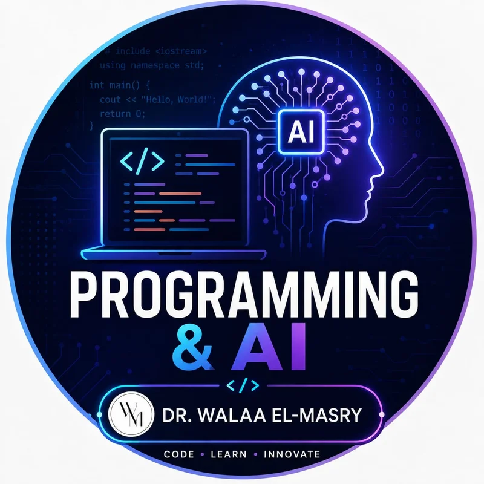

<div align="center">



# Interactive Activities
### Programming & AI · Year 2 Baccalaureate

**Owned by Dr. Walaa El-Masry**  
Developed by [@mohamed-Mma](https://github.com/mohamed-Mma)

<br/>


</div>

---

## ⚠️ Restricted Project

> This repository is **private intellectual property**.  
> It is **not open source** and **not free to use**.

| | |
|---|---|
| **Owner** | Dr. Walaa El-Masry |
| **Developer** | [@mohamed-Mma](https://github.com/mohamed-Mma) |
| **License** | All Rights Reserved |
| **Public use** | ❌ Not allowed without permission |

---

## 🚫 What is NOT allowed

Without **written permission** from the developer, you may **not**:

- ❌ Copy, clone, or fork this project  
- ❌ Reuse code, design, or activities  
- ❌ Modify and republish under another name  
- ❌ Use it for teaching, courses, or commercial work  
- ❌ Remove ownership or credit notices  

**Unauthorized use is strictly prohibited.**

---

## 🔐 Permission Required

Any use of this project requires prior approval from the developer:

### 👉 [@mohamed-Mma](https://github.com/mohamed-Mma)

Access to the source code does **not** mean you have permission to use it.

---

## 📜 License

```text
Copyright © Dr. Walaa El-Masry
All Rights Reserved.

No license is granted to the public to use, copy, modify,
merge, publish, distribute, sublicense, or sell any part
of this software or its content.

All rights remain with the owner.
